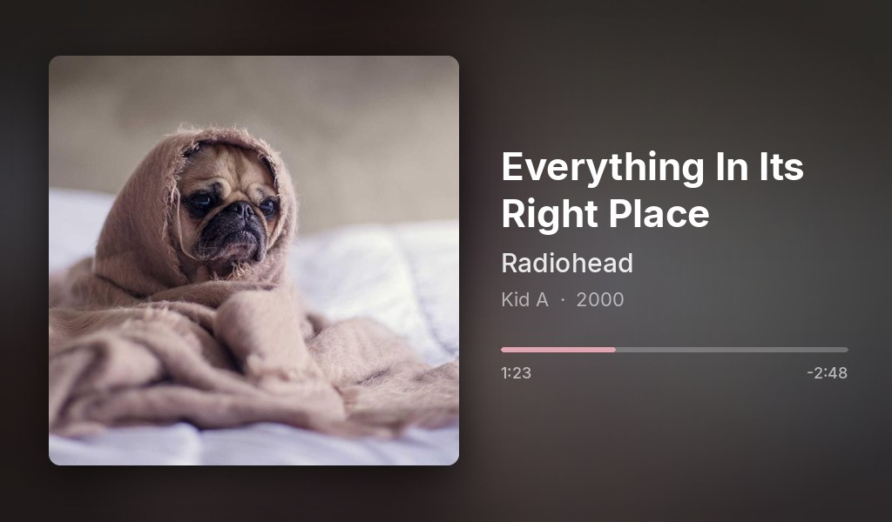
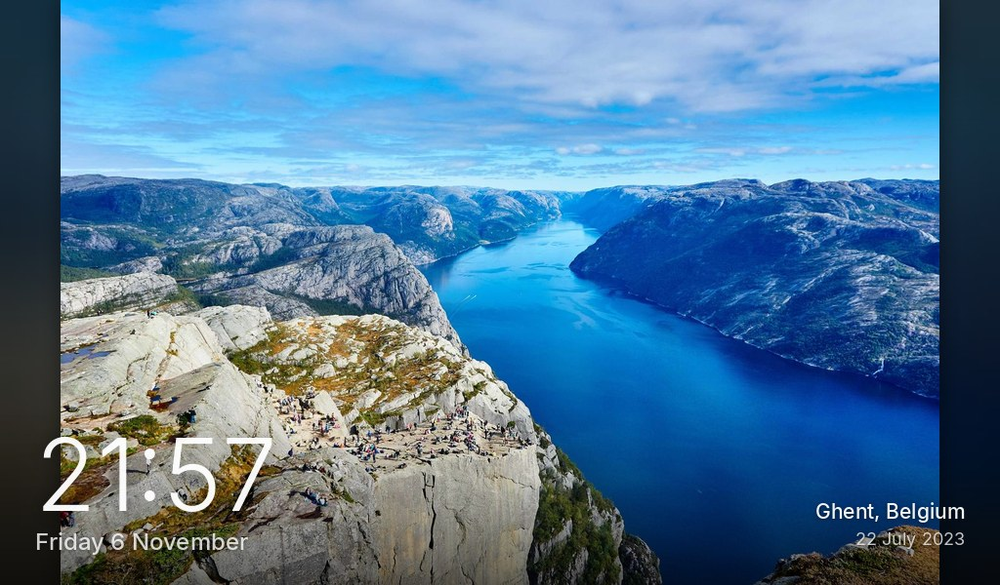
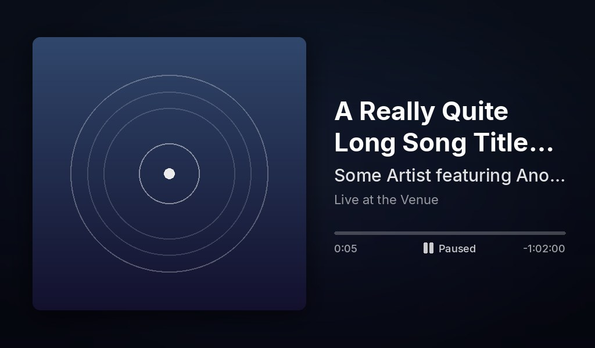
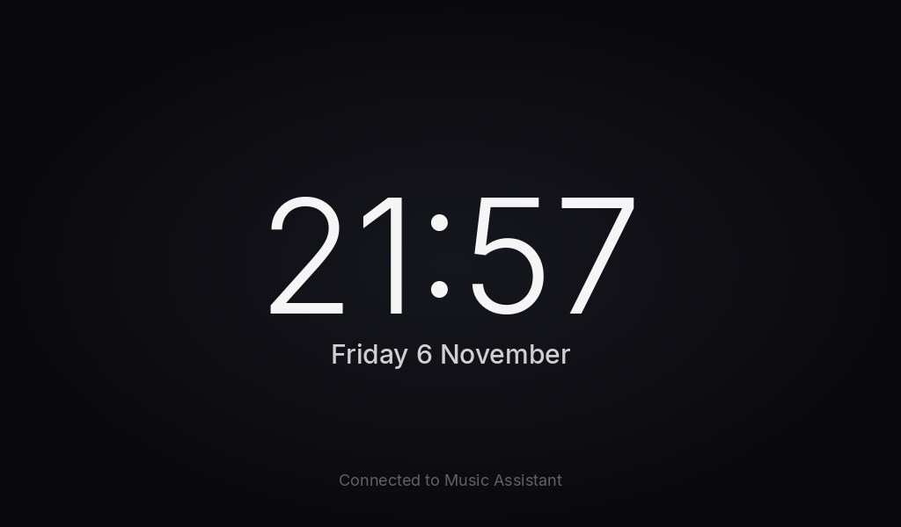

# sendspin-frame

A **Sendspin player for [Music Assistant](https://music-assistant.io)** that also drives a screen:
album art, title, artist and progress while music plays, and a **Nextcloud
[Photo Frames](https://apps.nextcloud.com/apps/photo_frames) slideshow** with a clock when idle.

It's built for a **Raspberry Pi Zero 2 W running Raspberry Pi OS Lite**. It needs no desktop,
X11, Wayland or browser. It draws straight into the Linux framebuffer with Pillow, so it starts in
seconds and leaves the Pi's 512 MB of RAM and CPU for the audio.

| Now playing | Idle: photo frame |
|---|---|
|  |  |
| **Paused, no cover art** | **Idle without photos** |
|  |  |

Portrait screens get a stacked layout ([screenshot](docs/screenshots/now-playing-portrait.jpg)).

## Features

- **Synchronised audio playback.** This is the official `sendspin daemon`, unchanged, so it stays
  in sync with your other Sendspin speakers. Volume, grouping, FLAC/PCM and reconnects all work
  the same.
- **Now playing screen.** Shows the cover art on a blurred backdrop taken from the cover. Long
  titles wrap and get truncated. The progress bar colour comes from the artwork. There is a pause
  indicator. Track changes crossfade.
- **Photo frame when idle.** Shows the current photo of your Nextcloud Photo Frames frame,
  including where and when it was taken, with a clock and the date. A small green or red badge
  in the corner shows whether Music Assistant is connected. The frame's rotation schedule
  is the one you set in Nextcloud. Photos crossfade.
- **Light on the Pi.** It only redraws what changes: a progress tick rewrites a few pixel rows.
  Decoding and rendering run in a low-priority thread, so the audio has priority.
- **Home Assistant control over MQTT.** Choose between the cover and the photo slideshow while
  music plays, from Home Assistant. The device sets itself up through MQTT discovery.
- **OLED burn-in protection.** Optionally moves the picture by a few pixels every few minutes.
- **Optional night mode.** The screen switches off in a time window you choose, and wakes up when
  music starts.
- Works with any framebuffer screen: HDMI, DSI or SPI, at 16 or 32 bpp, landscape or portrait,
  with software rotation.

## How it works

```
                 Music Assistant (Sendspin provider)
                          │  websocket, mDNS discovery
                          ▼
┌──────────── sendspin-frame (one process) ──────────────────┐
│ upstream `sendspin daemon`  ── roles: player               │──► ALSA ─► speakers
│   + metadata & artwork roles (title, progress, cover JPEG) │
│                │                                           │
│                ▼                                           │
│ render thread (Pillow) ── scenes, crossfades ──────────────│──► /dev/fb0 ─► screen
│                ▲                                           │
│ Photo Frames poller ── GET <frame-url>/image (+ Expires) ──│◄── Nextcloud
└────────────────────────────────────────────────────────────┘
```

- Sendspin's **artwork role** sends the cover as a JPEG at the exact size the screen needs. No
  extra HTTP requests or image scaling are needed. If a server only sends an `artwork_url`, that
  URL is fetched as a fallback.
- The Photo Frames app serves its current photo at `<frame url>/image`. It's public, needs no
  login, and has an `Expires` header that says when the next photo is due. sendspin-frame does
  what the app's web page does, without the web browser.

## What you need

- A Raspberry Pi Zero 2 W (any Pi works), running **Raspberry Pi OS Lite 64-bit** (Bookworm or
  Trixie).
- A screen: an HDMI monitor, the official DSI touch display, an SPI TFT, and so on.
- An audio output. The Zero has no headphone jack, so use HDMI audio, a USB DAC or an I²S DAC
  HAT.
- Music Assistant with the **Sendspin** player provider enabled.
- Optional: Nextcloud with the **Photos** and **Photo Frames** apps.

## Install (on the Pi)

```bash
sudo apt install -y git
git clone https://github.com/Benoit-LdL/sendspin_frame.git
cd sendspin_frame
sudo ./install.sh
sudo reboot
```

The installer does the following:
- Installs PortAudio and fonts (Inter, falling back to DejaVu), and [uv](https://docs.astral.sh/uv/).
- Creates the `sendspin` system user.
- Installs the app into `/opt/sendspin-frame`. uv provides Python ≥ 3.12, downloading it on
  Bookworm if needed.
- Writes `/etc/sendspin-frame/config.toml`.
- Installs and starts the `sendspin-frame` systemd service.
- Frees the screen for the app: disables the login prompt on tty1, and adds `consoleblank=0
  vt.global_cursor_default=0 logo.nologo` to `cmdline.txt`. A backup of `cmdline.txt` is saved
  next to it. Run with `--no-boot-tweaks` to skip the `cmdline.txt` changes.

Run it again after a `git pull` to update. Your config is kept.

The player then shows up in Music Assistant on its own, through mDNS.

## Configure

Edit `/etc/sendspin-frame/config.toml`, then run `sudo systemctl restart sendspin-frame`. Every
option is documented in [`config.example.toml`](config.example.toml). The ones you'll likely
touch:

```toml
[sendspin]
name = "Living Room Frame"            # name in Music Assistant
audio_device = ""                     # see below
delay_ms = 0                          # audio delay, to sync with other speakers
server_url = "ws://192.168.1.10:8927/sendspin"   # Music Assistant (recommended, see below)

[photos]
url = "https://cloud.example.com/apps/photo_frames/<token>"

[display]
pixel_shift = 6                       # OLED: move the picture a few pixels now and then
sleep = "23:30-07:00"                 # screen off at night, wakes for music
rotate = 0
```

### Home Assistant (MQTT)
With an MQTT broker (for example the Mosquitto add-on), add to the config:
```toml
[mqtt]
host = "192.168.1.10"        # your Home Assistant / broker address
username = "mqtt-user"
password = "..."
```
After a restart, a device named after the player shows up under **Settings → Devices &
services → MQTT**, with a **Screen during music** choice: *Cover art* or *Photo slideshow*. The
choice is kept across restarts, and can be used in automations, for example the slideshow only
during the evening. `now_playing.screen` in the config is the default until the first choice in
Home Assistant.

### OLED TVs and burn-in
Set `display.pixel_shift = 6`. Every `pixel_shift_minutes` (default 3) the whole picture moves to
a new spot, at most 6 pixels from the centre, like the "screen shift" of OLED TVs. The clock and
text then never stay on exactly the same pixels. Also turn on the TV's own protection features if
it has them ("Screen Shift", "Pixel Orbit", "Logo Luminance").

### Photo Frames link
In Nextcloud, open **Photos**, create an album with the photos you want, and then go to **Photo
Frames → New frame**. Pick the album and the rotation settings, such as *every 1 hour* or *daily
from 07:00 to 23:00*, and copy the frame's public link into `photos.url`. The link looks like
`https://<your-cloud>/apps/photo_frames/<64 characters>`.

### Boot text size
The text console shown while the Pi boots uses its own font. To make it smaller (or bigger), run
`sudo dpkg-reconfigure console-setup` (pick *Terminus* and a size such as `8x16` or `6x12`), or
set `FONTFACE` / `FONTSIZE` in `/etc/default/console-setup` and run `sudo setupcon`.

### Audio output
```bash
sudo -u sendspin /opt/sendspin-frame/.venv/bin/sendspin audio-devices list
```
Put the index or name you want into `sendspin.audio_device`. For HDMI audio on a Pi, pick the
`hdmi:` / `vc4hdmi` entry. For a DAC HAT, enable its overlay in `/boot/firmware/config.txt`
first.

### Sync with other speakers
Music Assistant can adjust the delay per player. You can also set a fixed delay in the config:
`delay_ms = 120` under `[sendspin]`.

## Troubleshooting

| Symptom | Fix |
|---|---|
| Nothing on screen | `journalctl -u sendspin-frame -e`. Check that `/dev/fb0` exists (`ls /dev/fb*`). On HDMI, the screen must be connected at boot. |
| Blinking cursor / text on top | Reboot after install (needs the `cmdline.txt` options). Check that `getty@tty1` is disabled. |
| Colours look wrong / picture garbled | Check `cat /sys/class/graphics/fb0/bits_per_pixel` (16, 24 or 32 are supported) and open an issue with the value. |
| No sound | Choose the device explicitly (see *Audio output*). `alsamixer` to check levels. |
| Player offline / not in Music Assistant | Set `server_url = "ws://MA_IP:8927/sendspin"` under `[sendspin]`: the player then connects to Music Assistant itself and reconnects after restarts. Without it, Music Assistant has to discover the player over mDNS, which can fail across Docker/VM networks or miss a quick restart. |
| Photos don't appear | Open `<your frame url>/image` in a browser. It must show a photo. For self-signed certs, set `photos.verify_tls = false`. |
| Slow screen changes, high CPU use | Set `transition_ms = 0` to turn off crossfades. On a big TV, also lower the screen resolution (see below). |
| Screen is upside down / sideways | `display.rotate = 180` (or `90` / `270`). |

### Lower the screen resolution

On a big TV the Pi often runs at 1920x1080 (2 million pixels per picture). At 1280x720 it has
less than half as many pixels to draw, which helps on a Pi Zero 2 W, and the TV upscales it.
The resolution is chosen at boot. Add a `video=` option to the end of the single line in
`/boot/firmware/cmdline.txt` (keep it all on one line), then reboot:

```bash
sudo sed -i '1 s/$/ video=HDMI-A-1:1280x720@60/' /boot/firmware/cmdline.txt
sudo reboot
```

`journalctl -u sendspin-frame | grep Framebuffer` should then show `1280x720`. Use `HDMI-A-2`
for the second HDMI port of a Pi 4 or 5. To go back to the TV's own choice, remove the
`video=...` option again.

## Development (no Pi needed)

```bash
uv venv && uv pip install -e .
# Render the screens to PNG to tweak the design:
python tools/preview.py --out previews --art cover.jpg --photo photo.jpg
# Full end-to-end test: a fake Music Assistant plus a fake Photo Frames server.
# --interface 127.0.0.1 keeps your real Music Assistant from discovering the test player.
python -m sendspin_frame --frame-config dev.toml --frame-device png:/tmp/screen.png \
    --settings-dir /tmp/sf-settings --interface 127.0.0.1 --disable-mpris &
python tools/test_server.py --art cover1.jpg --art cover2.jpg --photo p1.jpg --photo p2.jpg
# then watch /tmp/screen.png (e.g. `eog /tmp/screen.png`)
```
For `dev.toml`, set `photos.url = "http://127.0.0.1:8099/apps/photo_frames/test"`.

Project layout:

```
sendspin_frame/
  __main__.py    entry point: loads config, hands all other options to `sendspin daemon`
  daemon.py      upstream SendspinDaemon + metadata/artwork roles -> shared state
  engine.py      render thread: picks the screen, debounces, crossfades, partial updates
  renderer.py    Pillow scenes (now playing, photo, clock), fonts, colours
  display.py     framebuffer output (RGB565 dithering / XRGB8888), PNG output for testing
  photoframe.py  Nextcloud Photo Frames client
  config.py      TOML config
  state.py       thread-safe state shared between asyncio and the render thread
tools/           preview renderer and fake server for testing
systemd/         service unit
install.sh       Raspberry Pi installer
```

`sendspin` is pinned to an exact version, because sendspin-frame extends its daemon class. To
upgrade, bump the pin and run the end-to-end test.

## Credits

- [Sendspin](https://www.sendspin-audio.com) and the
  [sendspin CLI](https://github.com/Sendspin/sendspin-python-cli) by the Music Assistant / Open
  Home Foundation folks.
- [Photo Frames](https://github.com/jeppester/nextcloud-photo-frames) for Nextcloud by Jesper
  Sørensen.
- [Inter](https://rsms.me/inter/) typeface by Rasmus Andersson (SIL OFL).
- Sample images in the screenshots come from [Unsplash](https://unsplash.com) via picsum.photos.

## License

MIT, see [LICENSE](LICENSE).
